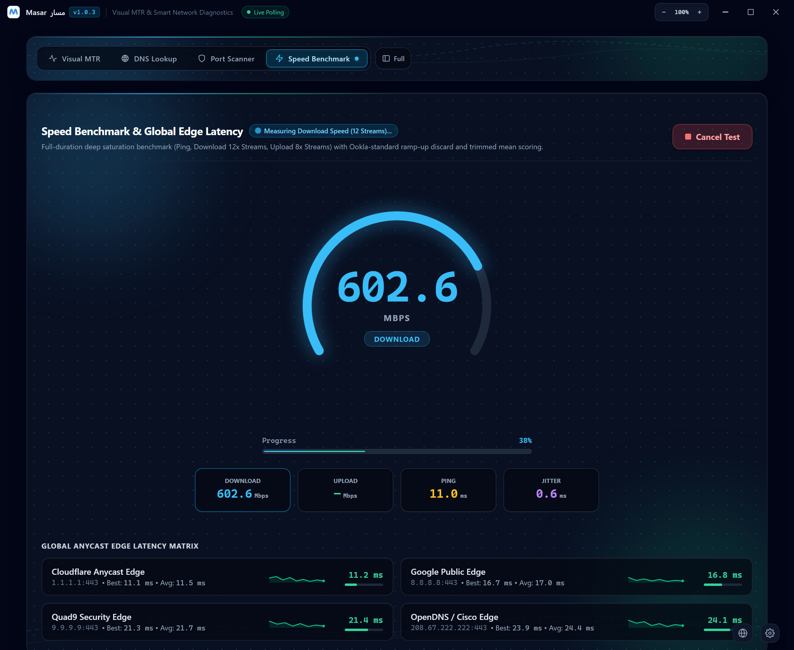
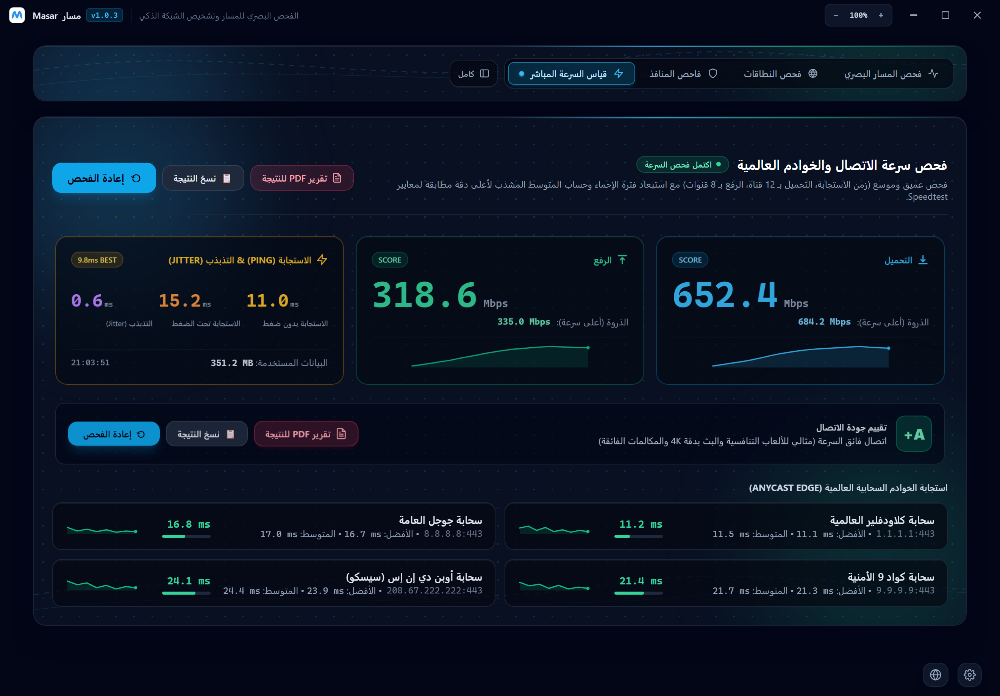

<div align="center">


# Masar · مسار

<p align="center">
  <strong>Native Windows Network Diagnostics, Visual MTR &amp; Speed Benchmark Suite</strong>
</p>
<p dir="rtl" align="center">
  <strong>أداة مكتبية احترافية لتشخيص الشبكة، وتتبع المسار البصري، وقياس السرعة بدقة لنظام ويندوز</strong>
</p>

[](https://github.com/mhmdrfx/masar/releases/latest)
[-0284c7?style=for-the-badge&logo=windows)](https://github.com/mhmdrfx/masar/releases/latest)
[](https://wails.io)
[](LICENSE)

<p align="center">
  <a href="https://github.com/mhmdrfx/masar/releases/latest">
    
  </a>
</p>

<h3>
  <a href="#-english-documentation">🇺🇸 English Documentation</a>
  &nbsp;&nbsp;|&nbsp;&nbsp;
  <a href="#-التوثيق-الكامل-باللغة-العربية">🇸🇦 التوثيق باللغة العربية</a>
</h3>

</div>

---

<a id="-english-documentation"></a>

# 🇺🇸 English Documentation

> Jump to section: [Overview](#-overview) · [Capabilities](#-key-capabilities) · [Screenshots](#-interface-preview) · [Installation](#-installation) · [Build from Source](#️-building-from-source) · [Architecture](#-project-architecture) · [Privacy & Signing](#-code-signing--privacy-policy) · [Switch to Arabic](#-التوثيق-الكامل-باللغة-العربية)

## 🌐 Overview

**Masar** is a lightweight, high-precision network diagnostics, route telemetry, and speed benchmarking desktop application engineered natively for **Windows 10 / 11 (`x64`)**. Built on a concurrent **Go** backend and a hardware-accelerated **Wails v2 / React** interface, Masar replaces fragmented command-line utilities (`ping`, `tracert`, `nslookup`, `netstat`) with a unified visual workbench.

Whether you are troubleshooting ISP routing bottlenecks, isolating real packet loss versus router ICMP rate-limiting, running deep multi-stream fiber speed benchmarks, or auditing DNS resolvers and TCP ports, Masar delivers actionable engineering telemetry in real time.

---

## ✨ Key Capabilities

| Module | Engineering Highlights |
| :--- | :--- |
| **Visual MTR & Route Tracer** | Concurrent low-level ICMPv4 Echo dispatcher (`TTL 1–30`) with per-hop `Loss%`, `Best`, `Avg`, `Worst`, `Last`, and `Jitter` metrics, automatic silent-router / rate-limit filtering, and shared TTL caches for PTR reverse DNS & Geo-IP/ASN lookups. |
| **Speedtest-Style Bandwidth Benchmark** | Deep staged saturation benchmark: 4s Ping/Jitter matrix, 15s Download (**12 parallel HTTP/2 streams**, 25MB–50MB payloads), and 12s Upload (**8 parallel incompressible streams**), featuring TCP slow-start discard, **80% Trimmed Mean** scoring, **Peak (Max Speed)** tracking, **Loaded Ping (Bufferbloat)** testing, and global CDN edge latencies (`Cloudflare`, `Google`, `Quad9`, `OpenDNS`). |
| **Bottleneck & Anomaly Engine** | Automated root-cause heuristics that distinguish harmless control-plane ICMP throttling on intermediate hops from genuine downstream packet loss or ISP peering congestion. |
| **DNS Inspector & Port Scanner** | Concurrent benchmarking across public and local gateway DNS resolvers (`A`, `AAAA`, `MX`, `TXT`, `NS`, `CNAME`) alongside a 20-worker concurrent TCP handshake port scanner with service detection. |
| **Official PDF & Report Studio** | Native Windows save-dialog export generating official **Printable HTML / PDF** speed & route reports (featuring the Masar vector logo, telemetry charts, and Peak/Score breakdowns), plus **CSV**, **JSON**, and **Plain-Text** formats. |
| **Bilingual UI & Adaptive Controls** | Instant **English (LTR)** / **Arabic (RTL)** switching, Dark & Light themes, titlebar zoom scaling (`80%–150%`), and Full/Compact navigation bar toggle. |

---

## 📸 Interface Preview

### 1. Visual MTR & Route Architecture (Dark Mode)
> Real-time ICMPv4 route tracing with per-hop latency telemetry, 4-stage packet topology (`Device → Local Gateway → ISP Backbone → Destination`), jitter trends, and Geo-IP / ASN attribution.

<p align="center">
  
</p>

### 2. Speedtest-Style Live Circular Dial Gauge
> Spacious 280px live dial gauge saturating Gigabit+ lines with 12 concurrent Download streams and 8 concurrent Upload streams via `speed.cloudflare.com` Anycast edges.

<p align="center">
  
</p>

### 3. Certified Speed Scorecard & Bufferbloat Telemetry
> Final sustained Speedtest-standard scorecards (with **Peak (Max Speed)** clarity, **Idle vs. Loaded Ping**, **Grade A+**, 1-click **PDF Report** export, and live Anycast edge response comparison).

<p align="center">
  
</p>

---

## 🚀 Installation

### Standard Installer (Recommended)

1. Download [**`Masar-Setup.exe`**](https://github.com/mhmdrfx/masar/releases/latest) from the [GitHub Releases](https://github.com/mhmdrfx/masar/releases/latest) page.
2. Run **`Masar-Setup.exe`** and follow the setup wizard (configures Desktop & Start Menu shortcuts, `AppUserModelID`, and checks Microsoft Edge WebView2 runtime).
3. Launch **Masar** from your Desktop or Start Menu (`Run as Administrator` is supported for raw ICMP socket access).

### Windows Package Manager (`winget`)

Install or upgrade Masar directly from PowerShell or Windows Terminal:

```powershell
# Install Masar
winget install mhmdrfx.Masar

# Upgrade to latest release
winget upgrade mhmdrfx.Masar
```

---

## 🛠️ Building from Source

### Prerequisites
- **Go** `1.23+`
- **Node.js** `20+` & `npm`
- **Wails CLI** `v2.11+` (`go install github.com/wailsapp/wails/v2/cmd/wails@latest`)
- **NSIS** `3.x` (required only when building `Masar-Setup.exe`)

### Build Commands

```powershell
# 1. Clone the repository
git clone https://github.com/mhmdrfx/masar.git
cd masar

# 2. Install frontend dependencies & bundle production assets
npm --prefix frontend ci
npm --prefix frontend run build

# 3. Run unit tests across all Go packages
go test -v ./...

# 4. Build standalone executable & NSIS Windows Installer
wails build -nsis -s
```

The compiled executable (`masar.exe`) and setup wizard (`Masar-Setup.exe`) will be placed in `build/bin/`.

---

## 📂 Project Architecture

```text
masar/
├── app.go                              # Wails application lifecycle, IPC bindings & updater hooks
├── app_windows.go                      # Windows AppUserModelID (mhmdrfx.Masar) & taskbar registration
├── main.go                             # Native window configuration & asset embedding
├── report_export.go                    # Native save-dialog & HTML/CSV/TXT Visual MTR report engine
├── report_speed.go                     # Official Speed Benchmark PDF/HTML report generator with vector emblem
├── updater.go / updater_windows.go     # Clean in-app SHA-256 verified auto-updater
├── internal/
│   ├── mtr/                            # Concurrent ICMPv4 tracer, silent-router filter, Geo/ASN cache
│   └── nettools/                       # 12x/8x Speedtest benchmark, DNS inspector & TCP port scanner
├── frontend/
│   └── src/
│       ├── App.jsx                     # Bilingual workbench UI (MTR, DNS, Ports, Speed Dial & Scorecard)
│       └── ReportStudio.jsx            # Interactive report preview & export modal
├── docs/screenshots/                   # Retina PNG interface captures
└── build/windows/installer/project.nsi # Custom NSIS installer script (Masar-Setup.exe)
```

---

## 🔏 Code Signing & Privacy Policy

### Code Signing Policy
Free code signing provided by [SignPath.io](https://about.signpath.io), certificate by [SignPath Foundation](https://signpath.org).

- **Committers and reviewers:** [@mhmdrfx](https://github.com/mhmdrfx)
- **Approvers:** [@mhmdrfx](https://github.com/mhmdrfx)

Every official release binary (`Masar-Setup.exe`) is built exclusively from this public repository by the automated GitHub Actions workflow [`release.yml`](.github/workflows/release.yml).

### Privacy Policy
Masar will **not** transfer any information to networked systems unless explicitly initiated by the user:
- **Route Tracing (MTR):** Sends ICMP probes solely to the user-entered host and resolves public hop Geo-IP/ASN metadata via `ip-api.com`.
- **Speed Benchmark:** Measures throughput against `speed.cloudflare.com` and latency against public DNS edges (Cloudflare, Google, Quad9, OpenDNS).
- **DNS Inspector & Port Scanner:** Queries only the selected resolvers and user-specified targets.
- **Updates:** Verifies official GitHub releases using SHA-256 checksums with full user control.

Masar contains **zero** third-party telemetry, tracking, analytics, or advertising. Diagnostic reports are saved locally only.

---

## 📄 License

Distributed under the **MIT License**. See [`LICENSE`](LICENSE) for full details.

<br />

---

<a id="-التوثيق-الكامل-باللغة-العربية"></a>

<div dir="rtl" align="right">

# 🇸🇦 التوثيق الكامل باللغة العربية

> الانتقال السريع: [نظرة عامة](#-نظرة-عامة) · [المميزات وآلية العمل](#-المميزات-الهندسية-وآلية-العمل) · [معاينة الواجهة](#-معاينة-واجهة-البرنامج) · [طريقة التثبيت](#-طريقة-التثبيت-والتحديث) · [البناء من المصدر](#️-البناء-من-المصدر-للمطورين) · [هيكل المشروع](#-هيكل-المشروع-البرمجي) · [الخصوصية والتوقيع](#-سياسة-التوقيع-الرقمي-والخصوصية) · [English Docs](#-english-documentation)

## 🧭 نظرة عامة

**مسار (<bdi>Masar</bdi>)** هو تطبيق مكتبي احترافي خفيف وعالي الدقة لتشخيص الشبكات، وتتبع المسار البصري، وقياس سرعة الإنترنت، صُمّم وطُوّر خصيصاً لنظام **<bdi>Windows 10 / 11 (x64)</bdi>** بلغة **<bdi>Go</bdi>** وإطار **<bdi>Wails v2</bdi>**. يجمع البرنامج بين سرعة الأداء الأصلي على مستوى النظام وواجهة رسومية حديثة تغنيك تماماً عن أدوات سطر الأوامر التقليدية المتفرقة مثل `<bdi>ping</bdi>` و `<bdi>tracert</bdi>` و `<bdi>nslookup</bdi>`.

سواء كنت تبحث عن سبب ارتفاع البينغ في الألعاب التنافسية، أو تريد التمييز بين الفقدان الحقيقي للحزم وتجاهل الراوترات الوسيطة، أو قياس السعة الحقيقية لخط الألياف والـ <bdi>5G</bdi> وفق معايير <bdi>Speedtest</bdi> واستخراج تقرير <bdi>PDF</bdi> رسمي لتقديمه لمزود الخدمة، فإن **مسار** يمنحك قراءة هندسية فورية ودقيقة.

---

## ✨ المميزات الهندسية وآلية العمل

| الوحدة | التفاصيل التقنية وآلية الفحص |
| :--- | :--- |
| **فحص السرعة الدقيق (<bdi>Speed Benchmark</bdi>)** | فحص عميق على مراحل وفق المعايير المعتمدة عالمياً (<bdi>Ookla / Fast.com</bdi>): فحص استجابة الحواف السحابية، ثم **12 قناة تحميل متزامنة** (بحزم <bdi>25MB–50MB</bdi>) و **8 قنوات رفع متزامنة** ببيانات غير قابلة للضغط عبر <bdi>speed.cloudflare.com</bdi>. |
| **معالجة الشوائب وتحديد الذروة والـ <bdi>Bufferbloat</bdi>** | تجاهل مرحلة التسارع الأولية (<bdi>TCP Slow-Start</bdi>) وحساب **المتوسط المقصوص (<bdi>80% Trimmed Mean</bdi>)** للوصول للسرعة المستقرة الحقيقية، مع عرض **الذروة (أعلى سرعة)** وفحص **الاستجابة تحت الضغط (<bdi>Loaded Ping</bdi>)** لكشف اختناقات الراوتر. |
| **تتبع المسار البصري (<bdi>Visual MTR</bdi>)** | إرسال حزم <bdi>ICMPv4 Echo</bdi> منخفضة المستوى لكل قفزة (<bdi>TTL 1–30</bdi>) مع حساب أفضل ومتوسط وأسوأ وآخر استجابة، والتذبذب (<bdi>Jitter</bdi>)، ونسبة الفقد، والموقع الجغرافي واسم مزود الخدمة (<bdi>Geo-IP / ASN</bdi>). |
| **محرك تصفية الراوترات الصامتة** | خوارزمية تحليل تلقائية تميّز بذكاء بين التجاهل الطبيعي لردود <bdi>ICMP</bdi> في قفزات العبور وبين فقدان الحزم أو الاختناق الحقيقي الذي يؤثر على اتصالك. |
| **مقارنة <bdi>DNS</bdi> وفاحص المنافذ (<bdi>TCP Ports</bdi>)** | استعلام متوازٍ لسجلات النطاقات (<bdi>A, AAAA, CNAME, MX, NS, TXT</bdi>) مع قياس زمن الاستجابة، وفاحص منافذ متزامن (<bdi>20 اتصالاً في وقت واحد</bdi>) لكشف المنافذ المفتوحة وزمن مصافحتها. |
| **تقارير الـ <bdi>PDF</bdi> الرسمية** | استخراج تقارير فنية عالية الدقة تحمل **شعار مسار الرسمي** وجداول مؤشرات الأداء والتقييم (<bdi>+A</bdi>) بصيغ **<bdi>PDF / HTML</bdi>** و **<bdi>CSV</bdi>** و **<bdi>JSON</bdi>** مع إشعار فوري بمسار حفظ الملف. |
| **واجهة عربية متكاملة ومرنة** | دعم أصيل للغة العربية (<bdi>RTL</bdi>) والإنجليزية (<bdi>LTR</bdi>)، والوضع الداكن والفاتح، مع أزرار تكبير وتصغير الواجهة (<bdi>80%–150%</bdi>) وخيار القائمة المدمجة أو الكاملة. |

---

## 📸 معاينة واجهة البرنامج

### 1. قياس السرعة والنتيجة النهائية الشاملة (الوضع الداكن)
> عرض السرعة المستقرة للتحميل والرفع مع **الذروة (أعلى سرعة)**، والاستجابة بدون ضغط وتحت الضغط، والتقييم العام (<bdi>+A</bdi>)، وزر استخراج تقرير <bdi>PDF</bdi>، ومراقبة 4 سحابات عالمية (<bdi>Cloudflare, Google, Quad9, OpenDNS</bdi>).

<p align="center">
  
</p>

### 2. تتبع المسار البصري والخريطة الشبكية (الوضع الفاتح)
> عرض حي لرحلة الحزم عبر 4 مراحل من جهازك حتى الوجهة النهائية، مع جدول تفصيلي لكل قفزة ونسب الفقد ومنحنى الاستجابة لآخر 60 ثانية.

<p align="center">
  
</p>

### 3. مركز التقارير الاحترافية وشرح المؤشرات
> مركز متكامل يترجم أرقام الفحص إلى توصيات واضحة لتقييم الألعاب التنافسية والمكالمات الصوتية وبث <bdi>4K</bdi>، مع خيارات التصدير الرسمية المتعددة.

<p align="center">
  
</p>

---

## 🚀 طريقة التثبيت والتحديث

### الطريقة الأولى: المثبت الرسمي (موصى بها)
1. قم بتحميل المثبت الرسمي [**<bdi>Masar-Setup.exe</bdi>**](https://github.com/mhmdrfx/masar/releases/latest) من صفحة [الإصدارات](https://github.com/mhmdrfx/masar/releases/latest).
2. شغّل ملف **<bdi>Masar-Setup.exe</bdi>** واتبع خطوات معالج التثبيت؛ حيث يقوم بإنشاء اختصارات سطح المكتب وقائمة ابدأ وتسجيل هوية التطبيق في شريط المهام والتحقق من وجود بيئة <bdi>WebView2</bdi>.
3. افتح برنامج **مسار** مباشرة وابدأ الفحص فوراً (يدعم التشغيل كمسؤول لقراءة حزم <bdi>ICMP</bdi> المباشرة).

### الطريقة الثانية: عبر مدير حزم ويندوز (<bdi>winget</bdi>)
يمكنك تثبيت البرنامج أو تحديثه إلى آخر إصدار بأمر واحد من نافذة الأوامر أو <bdi>PowerShell</bdi>:

```powershell
# لتثبيت مسار
winget install mhmdrfx.Masar

# للتحديث إلى أحدث إصدار
winget upgrade mhmdrfx.Masar
```

---

## 🛠️ البناء من المصدر (للمطورين)

### المتطلبات الأساسية
- **<bdi>Go</bdi>** إصدار `1.23+`
- **<bdi>Node.js</bdi>** إصدار `20+` مع `<bdi>npm</bdi>`
- **<bdi>Wails CLI</bdi>** إصدار `v2.11+` عبر الأمر: `<bdi>go install github.com/wailsapp/wails/v2/cmd/wails@latest</bdi>`
- **<bdi>NSIS</bdi>** إصدار `3.x` (مطلوب فقط عند بناء ملف التثبيت `<bdi>Masar-Setup.exe</bdi>`)

### أوامر البناء والتشغيل

```powershell
# 1. استنساخ المستودع
git clone https://github.com/mhmdrfx/masar.git
cd masar

# 2. تثبيت حزم الواجهة وبناء الملفات الثابتة
npm --prefix frontend ci
npm --prefix frontend run build

# 3. تشغيل الاختبارات البرمجية للتحقق من سلامة الحزم
go test -v ./...

# 4. بناء البرنامج التنفيذي وملف التثبيت الرسمي لنظام ويندوز
wails build -nsis -s
```

ستجد الملف التنفيذي (`masar.exe`) وملف المثبت (`Masar-Setup.exe`) داخل المجلد `build/bin/`.

---

## 📂 هيكل المشروع البرمجي

```text
masar/
├── app.go                              # إدارة دورة حياة التطبيق والربط البرمجي (Wails IPC)
├── app_windows.go                      # تعريف هوية التطبيق في شريط مهام ويندوز (AppUserModelID)
├── main.go                             # إعدادات النافذة الرئيسية وتضمين الموارد
├── report_export.go                    # محرك حفظ وتصدير تقارير تتبع المسار (HTML / CSV / TXT)
├── report_speed.go                     # محرك إنشاء تقارير فحص السرعة الرسمية (PDF / HTML) بالشعار
├── updater.go / updater_windows.go     # نظام التحديث التلقائي الآمن والتحقق ببصمة SHA-256
├── internal/
│   ├── mtr/                            # محرك فحص ICMPv4، وتصفية القفزات الصامتة، وذاكرة Geo/ASN
│   └── nettools/                       # محرك فحص السرعة (12/8 قنوات)، وفاحص DNS والمنافذ
├── frontend/
│   └── src/
│       ├── App.jsx                     # الواجهة الرئيسية ثنائية اللغة (MTR، DNS، المنافذ، السرعة)
│       └── ReportStudio.jsx            # نافذة معاينة التقارير وشرح جميع المؤشرات
├── docs/screenshots/                   # لقطات شاشة حديثة عالية الدقة لواجهة التطبيق
└── build/windows/installer/project.nsi # سكربت بناء المثبت الرسمي (Masar-Setup.exe)
```

---

## 🔏 سياسة التوقيع الرقمي والخصوصية

### سياسة التوقيع الرقمي (<bdi>Code Signing</bdi>)
توقيع الكود المجاني مقدم من [<bdi>SignPath.io</bdi>](https://about.signpath.io) والشهادة من [<bdi>SignPath Foundation</bdi>](https://signpath.org).
* **المساهمون والمراجعون والمعتمدون:** [<bdi>@mhmdrfx</bdi>](https://github.com/mhmdrfx)
* تُبنى جميع ملفات الإصدار الرسمية (<bdi>Masar-Setup.exe</bdi>) حصرياً عبر مسار النشر المؤتمت على GitHub Actions ([`<bdi>release.yml</bdi>`](.github/workflows/release.yml)) من هذا المستودع العام.

### سياسة الخصوصية (<bdi>Privacy Policy</bdi>)
برنامج **مسار** لا يرسل أو ينقل أي بيانات من جهازك إلى أي خادم خارجي إلا عند طلبك المباشر لبدء الفحص:
* **تتبع المسار (<bdi>Visual MTR</bdi>):** يرسل حزم <bdi>ICMP</bdi> للوجهة التي تحددها فقط، ويستعلم عن الموقع الجغرافي لعناوين الشبكة العامة عبر `<bdi>ip-api.com</bdi>`.
* **فحص السرعة (<bdi>Speed Benchmark</bdi>):** يقيس سرعة التحميل والرفع عبر `<bdi>speed.cloudflare.com</bdi>` وزمن الاستجابة لخوادم <bdi>DNS</bdi> العامة المذكورة.
* **فاحص المنافذ و <bdi>DNS</bdi>:** يتصل فقط بالخوادم والأهداف التي تُدخلها يدوياً.
* **التحديثات:** تتحقق من وجود إصدارات جديدة عبر GitHub بموافقتك الكاملة ومع التحقق من بصمة الملف (`SHA-256`).

لا يحتوي التطبيق على أي أكواد تتبع، أو إعلانات، أو جمع بيانات مخفي؛ وتُحفظ كافة التقارير محلياً على جهازك فقط.

---

## 📄 الرخصة

مرخّص بموجب **رخصة <bdi>MIT</bdi>** مفتوحة المصدر. راجع ملف [`LICENSE`](LICENSE) للتفاصيل الكاملة.

</div>

<div align="center">
  <br />
  <sub>Engineered &amp; Maintained by <a href="https://github.com/mhmdrfx"><strong>@mhmdrfx</strong></a> · طُوّر بعناية لخدمة مجتمع الشبكات</sub>
</div>
