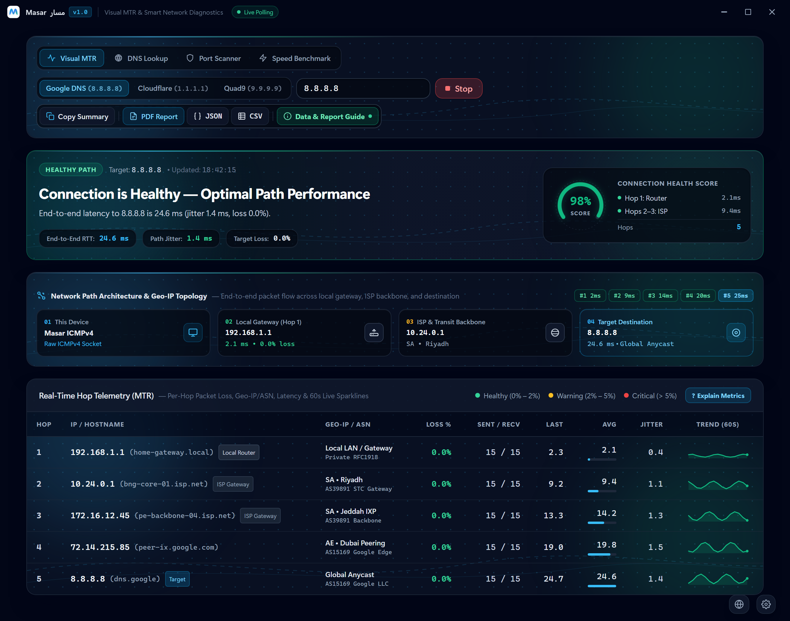
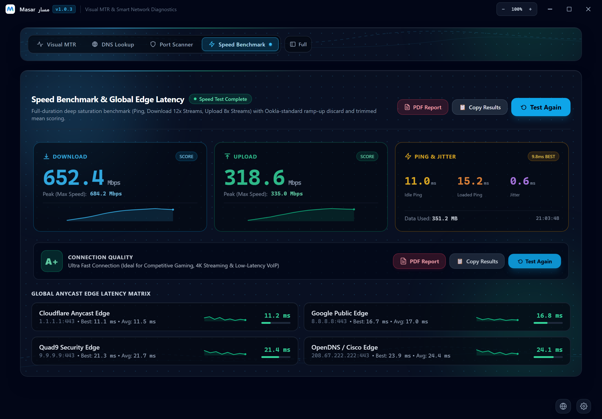
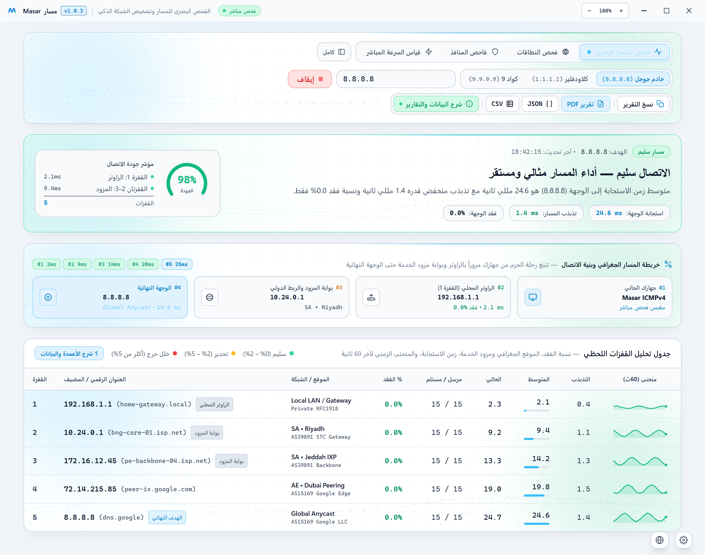
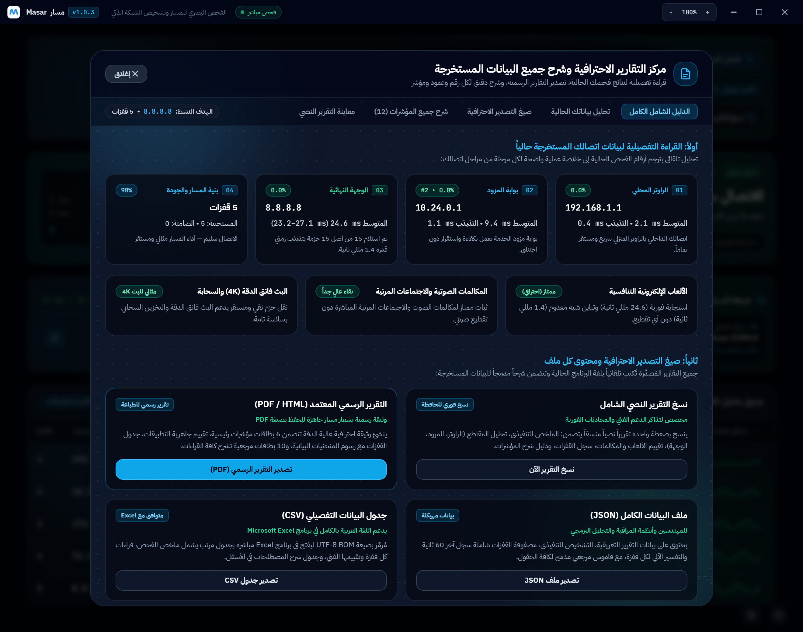

<div align="center">


# Masar · مسار

<p align="center">
  <strong>Native Windows Network Diagnostics, Visual MTR &amp; Route Intelligence Suite</strong>
</p>
<p dir="rtl" align="center">
  <strong>أداة مكتبية احترافية لتشخيص الشبكة، وتتبع المسار البصري، وتحليل جودة الاتصال لنظام ويندوز</strong>
</p>

[](https://github.com/mhmdrfx/masar/releases/latest)
[-0284c7?style=for-the-badge&logo=windows)](https://github.com/mhmdrfx/masar/releases/latest)
[](https://wails.io)
[](LICENSE)

<p align="center">
  <a href="https://github.com/mhmdrfx/masar/releases/latest">
    
  </a>
</p>

[**Overview**](#-overview) · [**نظرة عامة**](#-نظرة-عامة) · [**Screenshots · لقطات الشاشة**](#-interface-preview--معاينة-الواجهة) · [**Installation · التثبيت**](#-installation--طريقة-التثبيت) · [**Build from Source**](#️-building-from-source--البناء-من-المصدر)

<br />

</div>


## 🌐 Overview

**Masar** is a lightweight, high-precision network diagnostics and route telemetry desktop application engineered natively for Windows (`x64`). Built on a concurrent **Go** backend and a hardware-accelerated **Wails v2 / React** interface, Masar replaces fragmented command-line utilities (`ping`, `tracert`, `nslookup`, `netstat`) with a unified visual workbench.

Whether you are troubleshooting ISP routing bottlenecks, isolating real packet loss versus router ICMP rate-limiting, benchmarking high-speed fiber connections, or auditing DNS resolvers and TCP ports, Masar delivers actionable engineering telemetry in real time.

### ✨ Key Capabilities

| Module | Engineering Highlights |
| :--- | :--- |
| **Visual MTR & Route Tracer** | Concurrent ICMP Echo dispatcher with per-hop `Loss%`, `Best`, `Avg`, `Worst`, `Last`, and `Jitter` metrics, automatic router ICMP rate-limit filtering, and shared TTL caches for PTR & Geo-IP lookups. |
| **Bottleneck & Anomaly Engine** | Automated root-cause heuristics that distinguish harmless control-plane ICMP throttling on intermediate hops from genuine downstream packet loss or ISP peering congestion. |
| **Live Speed & Edge Benchmark** | Multi-stream download and upload bandwidth engine supporting Gigabit+ links, real-time throughput graphs, jitter measurement, and global CDN/DNS edge latency comparison (`Cloudflare`, `Google`, `Quad9`, `OpenDNS`). |
| **DNS Benchmark & Port Scanner** | Side-by-side latency benchmarking across public and local gateway DNS resolvers (`A`, `AAAA`, `MX`, `TXT`, `NS`, `CNAME`) alongside a concurrent TCP port scanner with service banners. |
| **ISP Report Studio** | Native save-dialog export generating self-contained **Printable HTML / PDF**, **CSV**, and **Plain-Text** diagnostic reports—complete with executive summaries, stability scores, and bilingual (`AR / EN`) formatting. |


<div dir="rtl" align="right">

---

## 🧭 نظرة عامة

**مسار (<bdi>Masar</bdi>)** هو تطبيق مكتبي احترافي خفيف وعالي الدقة لتشخيص الشبكات وتتبع المسار البصري، صُمّم خصيصاً لنظام **<bdi>Windows 10 / 11 (x64)</bdi>** باستخدام لغة **<bdi>Go</bdi>** وإطار **<bdi>Wails v2</bdi>**. يجمع البرنامج بين سرعة الأداء الأصلي للنظام وواجهة رسومية حديثة تغنيك عن استخدام أدوات سطر الأوامر التقليدية المتفرقة مثل `<bdi>ping</bdi>` و `<bdi>tracert</bdi>` و `<bdi>nslookup</bdi>`.

سواء كنت تبحث عن سبب ارتفاع زمن الاستجابة في الألعاب الإلكترونية، أو تريد التمييز بدقة بين الفقدان الحقيقي للحزم وتقييد الردود الوهمي في الموجهات الوسيطة، أو ترغب في استخراج تقرير فني موثّق لتقديمه لمزود خدمة الإنترنت، فإن **مسار** يمنحك قراءة هندسية فورية ودقيقة.

### ✨ المميزات الرئيسية

| الوحدة | التفاصيل التقنية |
| ---: | ---: |
| **تتبع المسار البصري (<bdi>Visual MTR</bdi>)** | فحص مستمر ومتزامن لكل قفزة على طول المسار مع حساب أفضل ومتوسط وأسوأ وآخر استجابة، ومؤشر التذبذب (<bdi>Jitter</bdi>)، ونسبة الفقدان، واسم المزود والموقع الجغرافي لكل خادم. |
| **محرك التشخيص الذكي للأعطال** | خوارزمية تحليل تلقائية تفرّق بدقة بين التجاهل الطبيعي لطلبات <bdi>ICMP</bdi> في قفزات العبور وبين اختناقات الشبكة أو فقدان الحزم الحقيقي الذي يؤثر على جودة اتصالك. |
| **فحص السرعة الحي وحواف الشبكة** | قياس فعلي لسرعة التنزيل والرفع عبر اتصالات متوازية متعددة تدعم سرعات الألياف البصرية العالية، مع مقارنة فورية لزمن الوصول لأشهر الخوادم العالمية مثل <bdi>Cloudflare</bdi> و <bdi>Google</bdi> و <bdi>Quad9</bdi> و <bdi>OpenDNS</bdi>. |
| **مقارنة <bdi>DNS</bdi> وفاحص المنافذ** | اختبار ومقارنة سرعة استجابة خوادم النطاقات العامة والمحلية مع استعلام شامل للسجلات، بالإضافة إلى فاحص منافذ <bdi>TCP</bdi> سريع ومتعدد المهام. |
| **استوديو التقارير الاحترافية** | تصدير مباشر عبر نافذة الحفظ في ويندوز لتقارير فنية شاملة بصيغة <bdi>HTML / PDF</bdi> جاهزة للطباعة أو <bdi>CSV</bdi> أو <bdi>TXT</bdi>، مع ملخص تنفيذي وتوصيات عملية باللغتين العربية والإنجليزية. |
| **دعم ثنائي اللغة والسمات** | واجهة متكاملة تدعم العربية (<bdi>RTL</bdi>) والإنجليزية (<bdi>LTR</bdi>) بتبديل فوري، مع الوضع الداكن والوضع الفاتح. |

</div>

---

## 📸 Interface Preview · معاينة الواجهة

### 1. Visual MTR & Route Architecture (Dark Mode)
> Real-time ICMP route tracing with per-hop latency metrics (`Best / Avg / Worst / Last`), jitter stability, packet-loss isolation, PTR reverse DNS, and Autonomous System / Geo-IP attribution.

<p align="center">
  
</p>

### 2. Multi-Stream Bandwidth & Anycast Edge Latency
> Live download and upload bandwidth testing powered by multi-stream HTTP/TLS workers, real-time throughput telemetry, unloaded vs. loaded ping analysis, and global CDN edge comparisons.

<p align="center">
  
</p>

### 3. Native Arabic Interface (`العربية RTL`) & High-Contrast Light Mode
> Seamless right-to-left Arabic typography, crisp Light Mode theme, 4-stage packet journey topology, and live hop stability sparklines.

<p align="center">
  
</p>

### 4. ISP Diagnostic Report Studio & Metric Guide
> One-click ISP diagnostic report generation (`HTML / PDF / CSV / JSON / Plain-Text`) with automated executive summaries and built-in metric threshold reference dictionary.

<p align="center">
  
</p>

---

## 🚀 Installation · طريقة التثبيت

### Standard Installation (Recommended · الطريقة الموصى بها)

1. Download [**`Masar-Setup.exe`**](https://github.com/mhmdrfx/masar/releases/latest) from the [Releases](https://github.com/mhmdrfx/masar/releases/latest) page.
2. Run **`Masar-Setup.exe`** and follow the setup wizard (automatically configures Desktop & Start Menu shortcuts and verifies the Microsoft Edge WebView2 runtime).
3. Launch **Masar** from your Desktop or Start Menu (`Run as Administrator` is supported for raw ICMP socket access).

### Windows Package Manager (winget)

Install or upgrade Masar directly from PowerShell or Terminal without visiting the browser:

```powershell
# Install
winget install mhmdrfx.Masar

# Upgrade to latest release
winget upgrade mhmdrfx.Masar
```

<div dir="rtl" align="right">

1. قم بتحميل المثبت الرسمي [**<bdi>Masar-Setup.exe</bdi>**](https://github.com/mhmdrfx/masar/releases/latest) من صفحة [الإصدارات](https://github.com/mhmdrfx/masar/releases/latest).
2. شغّل ملف **<bdi>Masar-Setup.exe</bdi>** واتبع خطوات معالج التثبيت؛ سيقوم تلقائياً بإنشاء اختصار على سطح المكتب وقائمة ابدأ والتحقق من بيئة التشغيل.
3. افتح برنامج **مسار** مباشرة من سطح المكتب وابدأ الفحص فوراً.
4. **التثبيت والتحديث عبر winget:** يمكنك تثبيت البرنامج أو تحديثه بنقرة واحدة من سطر الأوامر:
   `winget install mhmdrfx.Masar` أو `winget upgrade mhmdrfx.Masar`.

</div>

---

## 🛠️ Building from Source · البناء من المصدر

### Prerequisites
- **Go** `1.23+`
- **Node.js** `20+` & `npm`
- **Wails CLI** `v2.11+` (`go install github.com/wailsapp/wails/v2/cmd/wails@latest`)
- **NSIS** `3.x` (required only when building the `Masar-Setup.exe` installer)

### Commands

```powershell
# 1. Clone the repository
git clone https://github.com/mhmdrfx/masar.git
cd masar

# 2. Install frontend dependencies & build assets
npm --prefix frontend ci
npm --prefix frontend run build

# 3. Run unit tests across all Go packages
go test -v ./...

# 4. Build standalone executable & NSIS Windows Installer
wails build -nsis -s
```

The compiled application (`masar.exe`) and official setup wizard (`Masar-Setup.exe`) will be output to `build/bin/`.

---

## 📂 Project Architecture · هيكل المشروع

```text
masar/
├── app.go                              # Wails application lifecycle & IPC bindings
├── main.go                             # Native window configuration & asset embedding
├── report_export.go                    # Native save-dialog & HTML/CSV/TXT report generator
├── internal/
│   ├── mtr/                            # Concurrent ICMP Echo tracer, ring buffers, shared DNS/Geo cache
│   └── nettools/                       # Multi-stream speed test, DNS resolver benchmark & TCP port scanner
├── frontend/
│   └── src/
│       ├── App.jsx                     # Main bilingual workbench UI (MTR, Speed, DNS, Ports, Topology)
│       └── ReportStudio.jsx            # Interactive report preview & export modal
├── docs/screenshots/                   # High-resolution Retina PNG interface captures
└── build/windows/installer/project.nsi # Custom NSIS installer script (Masar-Setup.exe)
```

---

## 🔏 Code Signing Policy

Free code signing provided by [SignPath.io](https://about.signpath.io), certificate by [SignPath Foundation](https://signpath.org).

- **Committers and reviewers:** [@mhmdrfx](https://github.com/mhmdrfx)
- **Approvers:** [@mhmdrfx](https://github.com/mhmdrfx)

Every release binary (`Masar-Setup.exe`) is built exclusively from this public repository by the automated GitHub Actions workflow [`release.yml`](.github/workflows/release.yml). No binaries built on developer machines are signed.

### Privacy Policy

This program will not transfer any information to other networked systems unless specifically requested by the user or the person installing or operating it.

Network requests are only made when the user explicitly starts a diagnostic:

- **Route tracing / MTR:** ICMP packets to the destination host chosen by the user, and Geo-IP lookups of public hop addresses via `ip-api.com`.
- **Speed test:** download/upload measurements against `speed.cloudflare.com`, plus latency probes to public DNS edges (Cloudflare, Google, Quad9, OpenDNS).
- **DNS benchmark & port scanner:** queries only to the listed public resolvers and to the hosts entered by the user.

- **Updates:** checks official GitHub releases with full user consent and verification (SHA256).

Masar contains no third-party telemetry, analytics, or advertising. Diagnostic reports are saved locally only.

---

## 📄 License

Distributed under the **MIT License**. See [`LICENSE`](LICENSE) for full details.

<div align="center">
  <sub>Engineered &amp; Maintained by <a href="https://github.com/mhmdrfx"><strong>@mhmdrfx</strong></a></sub>
</div>
